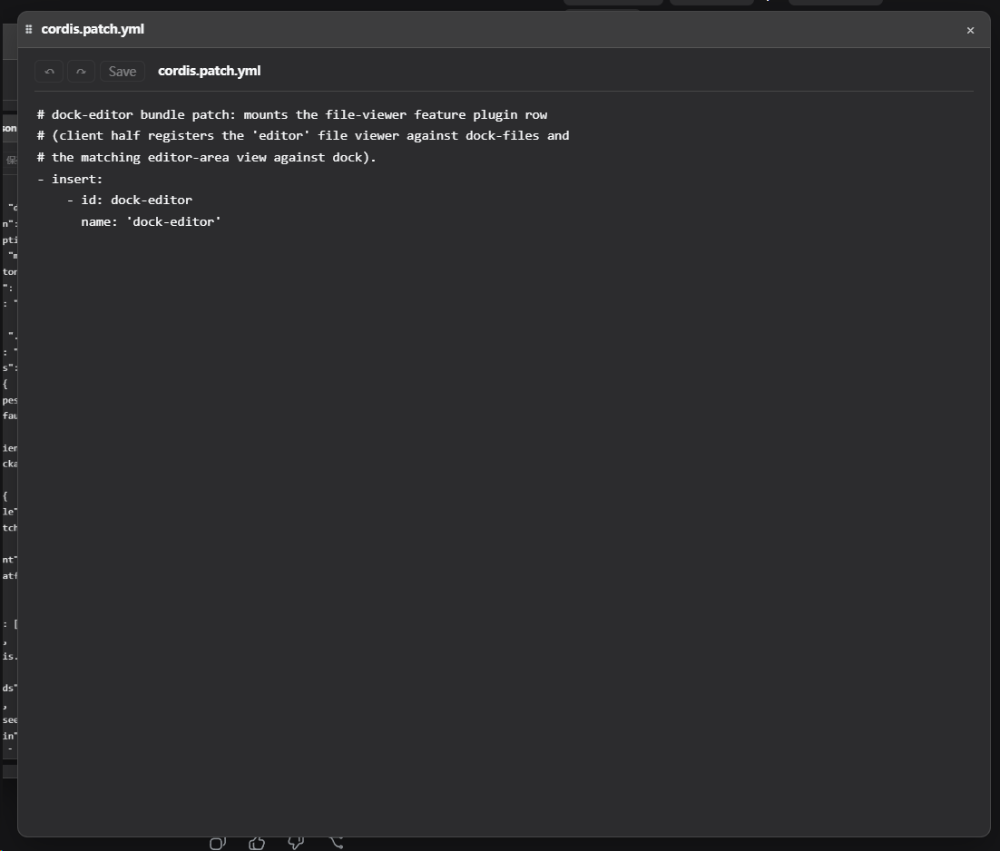

# dock-editor

[中文](README.md)

> **The best text editing plugin in the DSH ecosystem — no contest.** Reading code, tweaking configs or writing docs in DSH? dock-editor is the default answer: undo/redo, Ctrl+S save, unsaved-change confirmation, binary detection and floating-window geometry memory — all of it. Other viewers just display; dock-editor lets you actually change things.

Text viewer/editor plugin of the dock family: registers the `editor` file viewer (the default one) and the matching editor-area view; reads and writes file text through its own `/desk-editor` host route.

## Preview



## Features

- **Text viewing and editing**: textarea editing with a manual undo/redo stack (Ctrl+Z / Ctrl+Y) and Ctrl+S save.
- **Unsaved-change confirmation**: closing a window with unsaved edits asks for confirmation (via the workbench `beforeClose` hook and the seed dirty flag).
- **Binary detection**: NUL-byte probe on read; binary files show a notice instead of garbage.
- **Size cap**: single-file reads are capped at 256 KiB; larger files show only the first 256 KiB and **disable saving** so the original is never truncated (the host enforces the same check).
- **Floating-window geometry memory**: each file remembers its last floating-window position/size and restores it on reopen.

## Dependencies

| Dependency | Type | Notes |
| --- | --- | --- |
| [dock](https://github.com/AKS1st/dock) >= 0.1.0 | peer (required) | workbench shell: the editor-area view, floating windows and `ctx.workbench` come from it |
| [dock-files](https://github.com/AKS1st/dock-files) >= 0.1.0 | peer (required) | file-domain service: dock-editor is dispatched as its `editor` default viewer |
| DSH Web environment | runtime | required; client platform is Web |
| `cordis` ^4.0.0-rc.7 | peer | plugin framework (ships with DSH) |
| `react` ^18.2.0 | peer (optional) | needed for client rendering; without it the editor UI does not activate |

**Optional companions**: more viewers such as `dock-images` and `dock-markdown` can coexist with dock-editor, each taking over its own extensions (dock-editor remains the `default` fallback viewer).

## Install

Requires `dock` and `dock-files`:

```sh
dsh plugin add github:AKS1st/dock
dsh plugin add github:AKS1st/dock-files
dsh plugin add github:AKS1st/dock-editor
```

## Security

The `/desk-editor` route only accepts POSTs from trusted origins (loopback / trustedHosts plus same-origin check). Read paths only need to be absolute — they are not confined to the session workspace, because the conversation context can mention files outside it (e.g. `~/.dsh/skills/...`) and the viewers open them for viewing; writes remain confined to the session workspace (403 otherwise), and outside-workspace files open read-only in the editor; writes also verify the target size does not exceed the read cap.

## License

MIT
