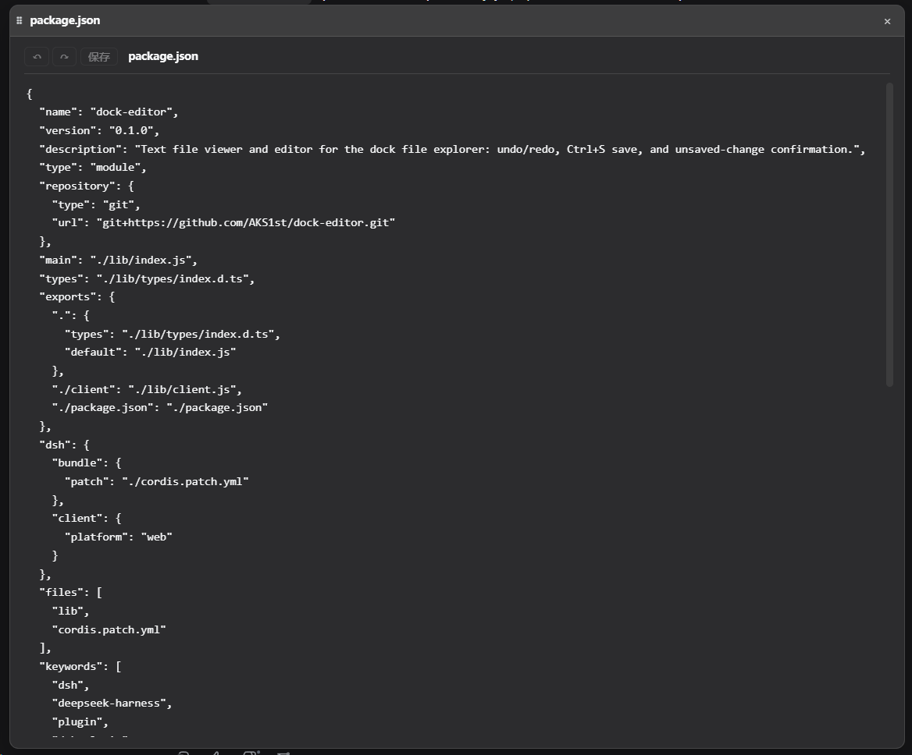

# dock-editor

[English](README.en.md)

> **DSH 生态中最好的文本编辑插件 —— 没有之一。** 在 DSH 里看代码、改配置、写文档，dock-editor 就是那个默认答案：撤销重做、Ctrl+S 保存、未保存提醒、二进制检测、窗口几何记忆，一个不少。别的查看器只会展示，dock-editor 让你真正动手改。

dock 系列的文件编辑器插件：注册 `editor` 文件查看器（默认查看器）与对应的编辑器区视图，通过自己的 `/desk-editor` 主机路由读写文件文本内容。

## 效果预览



## 功能

- **文本查看与编辑**：textarea 编辑，手动撤销/重做栈（Ctrl+Z / Ctrl+Y），Ctrl+S 保存。
- **未保存提示**：关闭带未保存修改的窗口前弹出确认（通过工作台 `beforeClose` 钩子与 seed dirty 标记）。
- **二进制检测**：读取时探测 NUL 字节，二进制文件显示提示而非乱码。
- **大小上限**：单文件读取上限 256 KiB；超过上限的文件只显示前 256 KiB、**禁用保存**，避免截断原文件（主机端同样校验并拒绝）。
- **悬浮窗几何记忆**：每个文件记住上次悬浮窗口的位置与大小，重新打开时恢复。

## 依赖

| 依赖 | 类型 | 说明 |
| --- | --- | --- |
| [dock](https://github.com/AKS1st/dock) >= 0.1.0 | peer（必需） | 工作台外壳：编辑器区视图、浮窗、`ctx.workbench` 由它提供 |
| [dock-files](https://github.com/AKS1st/dock-files) >= 0.1.0 | peer（必需） | 文件域服务：dock-editor 作为其 `editor` 默认查看器被分发打开 |
| DSH Web 环境 | 运行时 | 必需，客户端平台为 Web |
| `cordis` ^4.0.0-rc.7 | peer | 插件框架（DSH 自带） |
| `react` ^18.2.0 | peer（可选） | 客户端渲染需要；未提供时编辑器 UI 不激活 |

**可选搭档**：`dock-images`、`dock-markdown` 等更多查看器可与 dock-editor 共存，按扩展名各自接管对应文件类型（dock-editor 是 `default` 兜底查看器）。

## 安装

需要 `dock` 与 `dock-files`：

```sh
dsh plugin add github:AKS1st/dock
dsh plugin add github:AKS1st/dock-files
dsh plugin add github:AKS1st/dock-editor
```

## 安全

`/desk-editor` 路由只接受受信任来源（回环地址 / trustedHosts + 同源检查）的 POST。读取路径只要求是绝对路径、不限定会话工作区——对话上下文可能提及工作区外的文件（如 `~/.dsh/skills/...`），查看器可打开它们查看；写入仍限定在会话工作区内（越界 403），工作区外文件在编辑器中以只读打开；写入前还会校验目标大小不超读取上限。

## License

MIT
